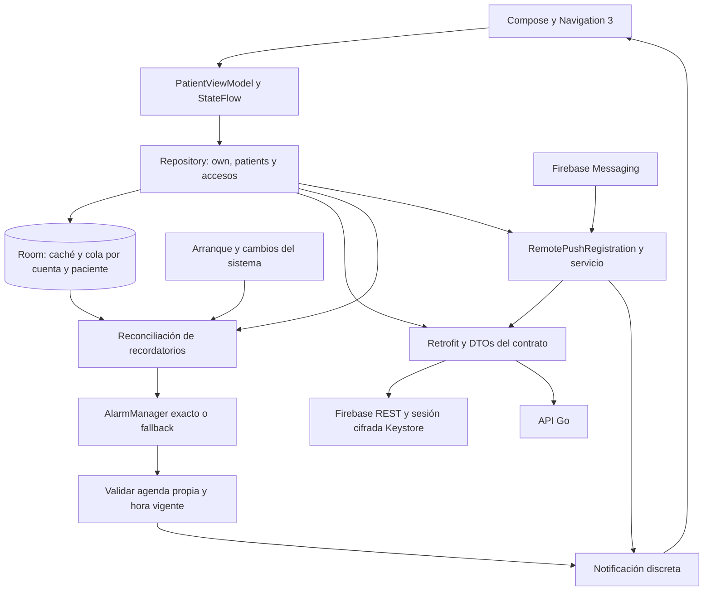

# Mapa de Android

La app Android permite consultar la agenda propia y las de pacientes que autorizaron al cuidador, declarar y corregir tomas según alcance, gestionar inventario y consentimiento. Cuenta, onboarding y preferencias de navegación forman parte de la app. El proyecto generado con Android CLI oficial compila con minSdk 26 y targetSdk 37. El flujo completo se verifica en emulador. El usuario aceptó F5 tras revisar la app en Xiaomi con Android 13; el runbook conserva los casos físicos pendientes.

## Responsabilidades e invariantes

- [`core/Repository.kt`](../app/src/main/kotlin/cl/nndsk/medication/core/Repository.kt) persiste antes de enviar, serializa operaciones y conserva conflictos. Una declaración se escribe en la cola sin esperar la sincronización en curso; un mutex corto la ordena con la limpieza del logout y nunca se sostiene durante la red. La respuesta idempotente no reemplaza el inventario actual. Primero envía la cola de todos los pacientes en orden. Después lee perfil, accesos y familias en paralelo, y carga hasta cuatro pacientes a la vez con sus recursos independientes concurrentes. Las páginas de una lista siguen en orden y las fechas usan la zona IANA del paciente. No solicita el resumen diario propio. Aplica los resultados por paciente en el orden de accesos; un fallo distinto de denegación conserva los snapshots anteriores ya aplicados y se informa. Los refrescos reemplazan la ventana de agenda sin reducir versiones. Las denegaciones recibidas de cualquier paciente se aplican antes de propagar errores recuperables de otros, y un 401 tiene prioridad y expira la sesión globalmente. Un 403/404 retira sólo el paciente afectado y mantiene sus operaciones como `denied` en Ajustes.
- [`core/LocalDatabase.kt`](../app/src/main/kotlin/cl/nndsk/medication/core/LocalDatabase.kt) separa cuenta y paciente en caché y cola. Las snapshots guardan nombres, perfil, accesos y resumen de la API para restaurar varias agendas sin conexión; no cambia el esquema Room. La unicidad por dosis impide doble acción local. El JSON del comando permanece inmutable hasta recibir respuesta o hasta descarte explícito de un rechazo/conflicto.
- [`core/Identity.kt`](../app/src/main/kotlin/cl/nndsk/medication/core/Identity.kt) ofrece acceso, registro y recuperación mediante Firebase REST. Conserva credenciales, correo y preferencia local de uso cifrados, comparte una renovación en curso entre sus llamadores y rechaza un cambio de cuenta sin logout. Tras un 401, la API informa qué token fue rechazado; si otro llamador ya lo renovó, reutiliza el vigente. El resultado fallido de una renovación se comparte sólo entre quienes la esperaban, y un intento posterior puede volver a renovar. La API reintenta la petición una sola vez. Datos privados y credenciales quedan excluidos de backups y transferencia.
- [`ui/App.kt`](../app/src/main/kotlin/cl/nndsk/medication/ui/App.kt) conserva la navegación. `ui/account/`, `ui/today/`, `ui/detail/` y `ui/settings/` contienen acceso, Hoy e Historial, detalle y Ajustes con consentimiento. `ui/components/` reúne las filas, tarjetas, acciones y estados compartidos. `ui/caregiver/` contiene la lista de pacientes, invitación con selector nativo para compartir y detalle Hoy/Historial/Inventario. Las pestañas se derivan de accesos, tratamientos propios y preferencia local; ésta no concede permisos. `PatientScreen` lleva un contexto explícito al reutilizar las pantallas de agenda, sin colocar pacientes ajenos en `own`. La revisión fija el comando enviado y la invitación que se acepta. Los registros pendientes y los saldos estimados se distinguen de los confirmados.
- Tras declarar, el repositorio envía la cola y renueva inventario y resumen ajeno de los pacientes aplicados. También renueva el inventario de sus compañeros locales de caja. Nunca lee ni aplica inventario de un paciente o caja con una operación todavía pendiente. Conserva en memoria los pacientes cuyo GET falló después de retirar el POST confirmado; el siguiente refresco selectivo vuelve a intentarlo y reiniciar ejecuta un refresco completo. Un conflicto 409 conserva la operación y vuelve a leer las dosis del día local afectado para mostrar versión y evento vigentes; si esa lectura falla, conserva la necesidad de reintentar. Cambiar nombre renueva perfil, accesos y familias, y reintenta las lecturas pendientes de cambios anteriores si existen. Los cambios familiares cargan agenda completa únicamente para accesos nuevos o cuyo vínculo, permisos o zona cambió. Reposición, conteo y cambios de caja renuevan sólo los inventarios afectados, sin agenda ni métricas.
- [`core/SyncRequests.kt`](../app/src/main/kotlin/cl/nndsk/medication/core/SyncRequests.kt) agrupa sólo refrescos pendientes de empezar. Una solicitud durante la lectura espera el ciclo posterior; una mutación separa los grupos y mantiene su escritura y refresco bajo el mutex. Cancelar un llamador no cancela el trabajo compartido. Entrar o salir de una sesión invalida los trabajos pendientes anteriores. El indicador ocupado incluye los grupos pendientes. El arranque usa `restore`; el primer resume y el callback inicial de la misma red disponible no añaden refrescos. Volver a primer plano, recuperar una conexión ausente o recibir otra red predeterminada sí los solicita. Una pérdida tardía de la red anterior no invalida la nueva.
- [`notifications/Reminders.kt`](../app/src/main/kotlin/cl/nndsk/medication/notifications/Reminders.kt) reconcilia sólo alarmas de la agenda propia (`patientId == actorId`) y vuelve a comprobar ese origen y el instante antes de entregar, incluso para alarmas antiguas. El receptor no escribe eventos de dosis. La ventana se repone al sincronizar y se reconstruye desde Room después de reinicio.

- [`core/TodayPlan.kt`](../app/src/main/kotlin/cl/nndsk/medication/core/TodayPlan.kt) reparte Hoy con las mismas reglas que iOS, y `LateTime` en [`core/EffectiveTime.kt`](../app/src/main/kotlin/cl/nndsk/medication/core/EffectiveTime.kt) impide horas futuras. Sólo presentan. Una dosis con más de 4 horas de atraso sale de la tarjeta y pasa a «Pasaron sin registrar», sin cambiar su estado. Declarar desde Hoy registra directamente, como en iOS; las correcciones conservan motivo y revisión. `AppState.offline` identifica el último intento sin conexión: omite el onboarding para permitir usar la caché, rotula los datos guardados y deshabilita las mutaciones de inventario. `rejected` e `informational` distinguen rechazos y avisos informativos en la presentación.
- Detalle y Ajustes se agrupan en tarjetas por sección, bajo una barra superior con título y botón de volver. Corregir un registro se hace en una hoja aparte, con motivo obligatorio. Historial incluye las tomas de hoy cuya hora ya pasó, como iOS.
- Los iconos de navegación y estado son vectores en `res/drawable`, sin dependencia de `material-icons`.

La lista de pacientes usa métricas de la API con período y denominador, sin contarlas desde páginas de dosis. Cada tarjeta se abre completa, llama «hoy» sólo al informe del día en la zona del paciente y muestra avisos únicamente si hay algo que revisar. El detalle usa pestañas reales y un menú en la barra superior para cambiar nombre y dejar de seguir. `ui/family/` contiene la pantalla Familia: miembros con rol y avatar, invitación por rol con QR (ZXing core, sólo el codificador), ingreso con código o con el enlace `mistomas://unirse#…` que declara el manifiesto, y salida. Hoy ofrece el ingreso mientras no haya tomas ni familia, y avisa al paciente quién se unió durante su primera semana. La familia llega con la sincronización y se guarda en el snapshot propio. La navegación se reinicia cuando cambia la cuenta. «Misma caja» pide contar la caja antes de compartir. Las declaraciones ajenas usan tercera persona; los alcances controlan las acciones visibles y el backend autoriza cada petición. Reposición y conteo requieren conexión y conservan su clave idempotente al reintentar; sólo las declaraciones se encolan offline. No se editan tratamientos ni se gestionan pools familiares desde esta fase. Los contratos compartidos y la autorización se describen en el [mapa del monorepo](../../../docs/00-home.md).

## Verificación y operación

- [Decisión F5](../../../docs/decisions/0006-f5-android-patient-app.md).
- [Pruebas F5 y pendientes físicos](../../../docs/runbooks/f5-verification.md).
- [Configuración y comandos](../../../docs/runbooks/development.md#android-f5).
- [Contrato compartido](../../../packages/contracts/openapi.yaml).

## Avisos remotos F6

[RemotePush.kt](../app/src/main/kotlin/cl/nndsk/medication/notifications/RemotePush.kt) registra el token FCM con identidad verificada, permiso y un ID estable distinto por cuenta e instalación. Renueva el registro al entrar, sincronizar, volver a foreground y recibir un token nuevo. El servicio muestra texto genérico y abre la app, sin registrar declaraciones.

Firebase Messaging está fijado a 26.0.1 en el catálogo de versiones y sus dependencias en el lockfile. Su mínimo API 24 es compatible con minSdk 26 del proyecto, según las [notas oficiales](https://firebase.google.com/support/release-notes/android). Se usa el modo de token compatible con el contrato HTTP v1 del servidor. `getToken`, `deleteToken` y `onNewToken` siguen disponibles pero están deprecados en este SDK. Migrar al nuevo modo FID exige cambiar también el destino del envío en el servidor; F6 no activa `firebase_messaging_installation_id_enabled`. Analytics y auto-init están desactivados en el manifest. La app habilita el registro sólo con sesión y permiso.

Configurar `firebaseProjectId`, `firebaseAppId` y `firebaseSenderId` como propiedades de Gradle junto a la API key pública ya existente. `firebaseAppId` es el identificador Firebase `1:…:android:…`, no el applicationId de Android. El paquete registrado en Firebase debe coincidir con el variant instalado, incluido su sufijo. No se usa `google-services.json` ni se añaden claves de servicio. Sin estos valores, o con Auth emulado, Ajustes oculta la sección de avisos remotos y mantiene los recordatorios locales.

Logout intenta DELETE en la API durante cinco segundos, desactiva auto-init e intenta borrar el token durante otros cinco segundos. Después borra la identidad aunque no haya red. Si falla la revocación remota, muestra que puede quedar un aviso genérico hasta el vencimiento del registro. El callback de token nunca registra una instalación sin sesión. Las notificaciones ya aceptadas por FCM pueden seguir siendo entregadas; el payload del servidor no contiene datos médicos.

Las pruebas unitarias verifican identidad por instalación/cuenta y el cuerpo del contrato. Build y lint no acreditan entrega FCM real. Falta probarla con configuración Firebase y permisos en un dispositivo registrado.

## Cierre de sesión F8

Logout oculta el estado inmediatamente y ejecuta la limpieza bajo el mutex del repositorio sin cancelación. Intenta desregistrar push, borrar credenciales y limpiar Room de forma independiente. Un fallo de Room no vuelve a publicar el snapshot anterior. La identidad conserva una marca de borrado pendiente que impide restaurar credenciales cuando la eliminación quedó incompleta.

Los fallos se muestran sin afirmar que todos los datos fueron borrados. La pantalla de acceso permite reintentar la limpieza sin autenticarse. El borrado lógico no acredita saneamiento forense ni protección del selector de aplicaciones. Ver [verificación F8](../../../docs/runbooks/f8-verification.md).

## Inventario compartido

El snapshot de cada paciente trae `pool` por cuenta. Room no cambia de esquema porque el snapshot se guarda como JSON. [`SharedInventory.kt`](../app/src/main/kotlin/cl/nndsk/medication/ui/caregiver/SharedInventory.kt) permite elegir otra cuenta, ingresar el conteo físico de la caja y compartirla de inmediato; también muestra el estado y permite salir. Ya no hay propuestas ni decisiones pendientes. Compartir y salir requieren red y no entran a la cola. El estimado local sigue restando sólo las declaraciones pendientes de este teléfono.

## Datos de la cuenta

[`AccountActions.kt`](../app/src/main/kotlin/cl/nndsk/medication/ui/account/AccountActions.kt) guarda la exportación en `cache/exports`, la comparte con `FileProvider` y la borra al volver. Eliminar la cuenta exige escribir BORRAR y, si el servidor quitó la identidad, limpia el teléfono con el mismo cierre de sesión.
