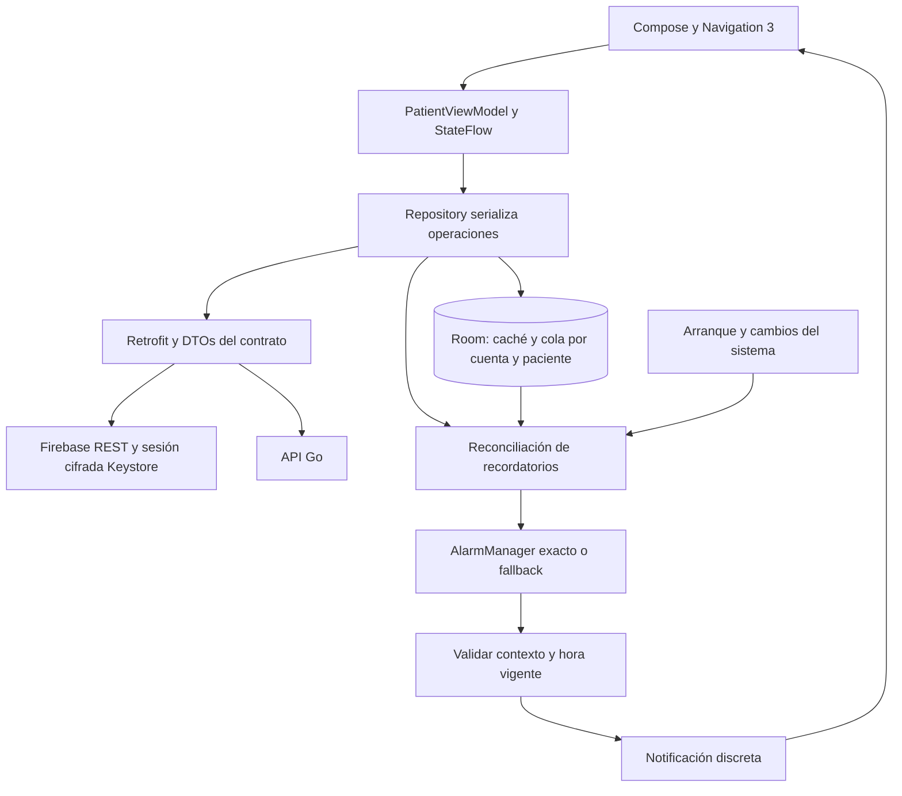

# Mapa de Android

La app Android de F5 permite al paciente consultar su agenda, declarar y corregir tomas, aceptar consentimiento y gestionar recordatorios. El proyecto generado con Android CLI oficial compila con minSdk 26 y targetSdk 37. El flujo completo se verifica en emulador. El usuario aceptó F5 tras revisar la app en Xiaomi con Android 13; el runbook conserva los casos físicos pendientes.

## Responsabilidades e invariantes

- [`core/Repository.kt`](../app/src/main/kotlin/cl/nndsk/medication/core/Repository.kt) persiste antes de enviar, serializa operaciones y conserva conflictos. La respuesta idempotente no reemplaza el inventario actual. Los refrescos reemplazan la ventana de agenda sin reducir versiones.
- [`core/LocalDatabase.kt`](../app/src/main/kotlin/cl/nndsk/medication/core/LocalDatabase.kt) separa cuenta y paciente en caché y cola. La unicidad por dosis impide doble acción local. El JSON del comando permanece inmutable hasta recibir respuesta o hasta descarte explícito de un rechazo/conflicto.
- [`core/Identity.kt`](../app/src/main/kotlin/cl/nndsk/medication/core/Identity.kt) conserva credenciales cifradas, serializa renovaciones y rechaza un cambio de cuenta sin logout. Datos privados y credenciales quedan excluidos de backups y transferencia.
- [`ui/PatientApp.kt`](../app/src/main/kotlin/cl/nndsk/medication/ui/PatientApp.kt) muestra Hoy, Historial, Ajustes, consentimiento y detalle de dosis. La revisión fija el comando enviado y la invitación que se acepta. Los registros pendientes y los saldos estimados se distinguen de los confirmados.
- [`notifications/Reminders.kt`](../app/src/main/kotlin/cl/nndsk/medication/notifications/Reminders.kt) reconcilia alarmas y comprueba contexto/instante antes de entregar. El receptor no escribe eventos de dosis. La ventana se repone al sincronizar y se reconstruye desde Room después de reinicio.

F5 selecciona el acceso propio devuelto por la API. No existe todavía el selector ni la vista del cuidador de F5b. Los contratos compartidos y la autorización se describen en el [mapa del monorepo](../../../docs/00-home.md).

## Verificación y operación

- [Decisión F5](../../../docs/decisions/0006-f5-android-patient-app.md).
- [Pruebas F5 y pendientes físicos](../../../docs/runbooks/f5-verification.md).
- [Configuración y comandos](../../../README.md#android-f5).
- [Contrato compartido](../../../packages/contracts/openapi.yaml).
