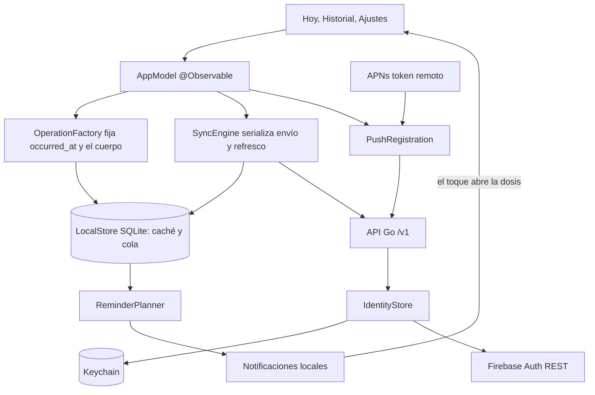
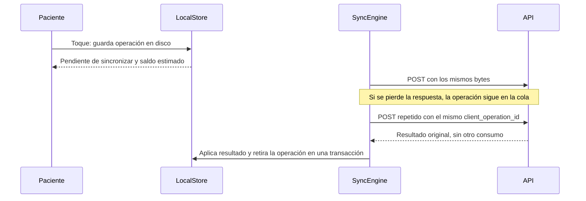

# Mapa de iOS

App SwiftUI del paciente: agenda de hoy, tres declaraciones, historial con corrección, consentimiento y recordatorios locales. Registra declaraciones, no ingestión, y no recomienda cambiar ni compensar dosis. Los contratos y el backend se describen en el [mapa del monorepo](../../../docs/00-home.md).



## Declarar sin conexión



## Invariantes

- La declaración está en disco antes de cualquier intento de red. Una dosis admite una operación activa.
- 409, 400/422 y 403/404 dejan la operación visible en «Por revisar», o en Ajustes si su dosis ya no está en la agenda. Sólo la persona puede resolverla.
- El saldo confirmado viene del servidor. El estimado se calcula aparte, con decimal exacto, y se rotula como tal.
- «Sin confirmar» se deriva del reloj y nunca se presenta como omitida. Las dosis futuras no admiten declaración, igual que en la API.
- Abrir un recordatorio nunca declara. Su texto no incluye el nombre del medicamento.
- Los cuerpos y datos médicos no se registran en logs. La base local queda fuera de las copias de seguridad.

## Responsabilidades

- [AppModel](../MedicationTracker/App/AppModel.swift) coordina sesión, sincronización, reintentos y navegación desde avisos.
- [SyncEngine](../MedicationTracker/Core/Sync/SyncEngine.swift) clasifica las respuestas. [LocalStore](../MedicationTracker/Core/Persistence/LocalStore.swift) es dueño de la caché, la cola y el propietario de los datos.
- [IdentityStore](../MedicationTracker/Core/Auth/IdentityStore.swift) es el único dueño de las credenciales.
- [ReminderPlanner](../MedicationTracker/Core/Notifications/ReminderPlanner.swift) decide qué recordar. [ReminderScheduler](../MedicationTracker/Core/Notifications/ReminderScheduler.swift) reconcilia con el sistema y diagnostica permisos.
- [DesignSystem](../MedicationTracker/DesignSystem/DesignSystem.swift) define colores semánticos con contraste verificado y los textos de estado.

## Proyecto y pruebas

[project.yml](../project.yml) genera el proyecto; `.xcodeproj` no se versiona. La configuración pública está en [Config](../Config). Debug admite HTTP hacia loopback y nombres `.local`. Release mantiene `NSAllowsLocalNetworking` en el plist, pero `AppConfig` rechaza todo lo que no sea HTTPS. Las razones están en la [decisión F4](../../../docs/decisions/0005-f4-ios-patient-app.md) y la evidencia y los pendientes en la [verificación F4](../../../docs/runbooks/f4-verification.md).

La [política común](../../../AGENTS.md#living-architecture) aplica a esta app sin duplicarla.

## Avisos remotos F6

[RemotePush.swift](../MedicationTracker/Core/Notifications/RemotePush.swift) recibe el token de APNs y registra una instalación distinta por cuenta. El registro se renueva al entrar, sincronizar, volver a foreground y cambiar el token o permiso. La API deriva el propietario desde la sesión. El cliente no envía pacientes ni tratamientos en el registro y nunca registra el token en logs.

Push está desactivado por defecto. Para una firma con capacidad APNs, añadir a `Config/Local.xcconfig` los valores públicos siguientes y configurar el App ID y perfil en Apple Developer.

```xcconfig
REMOTE_PUSH_ENABLED = YES
CODE_SIGN_ENTITLEMENTS = Config/Push.entitlements
APNS_ENVIRONMENT = development
```

Usar `production` para la firma y el servidor APNs correspondientes a distribución. No habilitar esta configuración con un perfil personal que carezca de push. Los builds locales y el emulador de identidad no requieren APNs.

Logout espera el registro en curso, intenta desregistrar en la API y llama a `unregisterForRemoteNotifications` antes de borrar la identidad. Un fallo de red no bloquea el cierre. Se informa que el servidor podría conservar el registro hasta su vencimiento. Los avisos remotos son genéricos y sólo abren la app. No crean declaraciones ni añaden la vista de cuidador de F5b.

Las pruebas de contrato usan transporte controlado. La compilación y los tests en simulador no acreditan entrega APNs real; ésta necesita firma habilitada, credenciales del proveedor y un dispositivo registrado.
