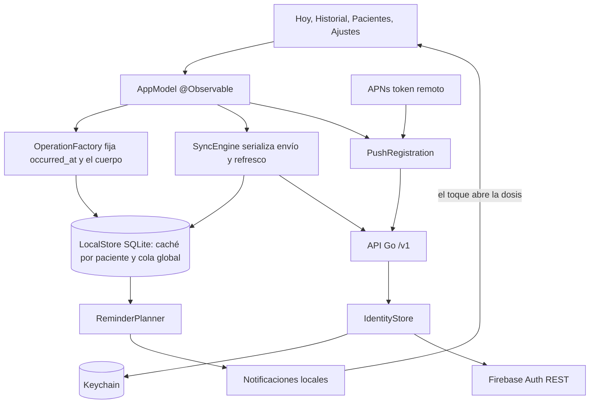
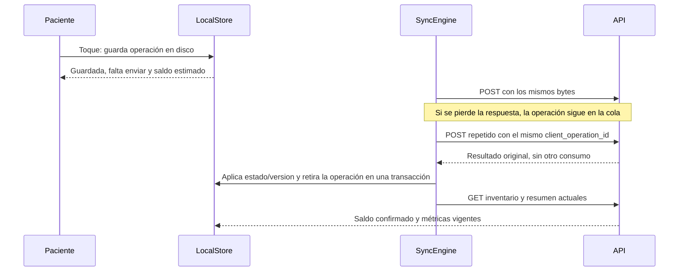
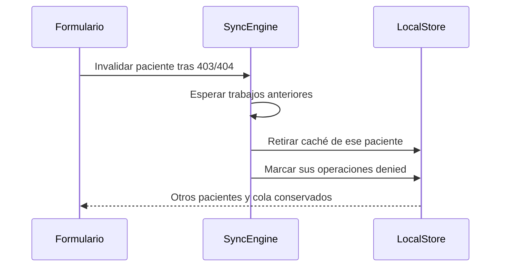

# Mapa de iOS

App SwiftUI con agenda propia y acceso a pacientes autorizados. Conserva las tres declaraciones, historial con corrección, consentimiento y recordatorios locales sólo propios. Registra declaraciones, no ingestión, y no recomienda cambiar ni compensar dosis. Los contratos y el backend se describen en el [mapa del monorepo](../../../docs/00-home.md).



## Declarar sin conexión



## Invariantes

- La declaración está en disco antes de cualquier intento de red. Una dosis admite una operación activa.
- 409, 400/422 y 403/404 dejan la operación visible en «Por revisar», o en Ajustes si su dosis ya no está en la agenda. Sólo la persona puede resolverla.
- El saldo confirmado viene de la lectura actual de inventario; el balance incluido en un replay puede ser histórico y no reemplaza la caché. El estimado se calcula aparte, con decimal exacto, y se rotula como tal.
- «Sin confirmar» se deriva del reloj y nunca se presenta como omitida. Las dosis futuras no admiten declaración, igual que en la API.
- Abrir un recordatorio nunca declara. Su texto no incluye el nombre del medicamento. El planificador exige que el paciente coincida con el identificador interno propio; las agendas ajenas nunca generan recordatorios.
- Los cuerpos y datos médicos no se registran en logs. La base local queda fuera de las copias de seguridad.

## Responsabilidades

- [AppModel](../MedicationTracker/App/AppModel.swift) coordina sesión, sincronización, reintentos y navegación desde avisos.
- [SyncEngine](../MedicationTracker/Core/Sync/SyncEngine.swift) clasifica las respuestas. [LocalStore](../MedicationTracker/Core/Persistence/LocalStore.swift) es dueño de la caché, la cola y el propietario de los datos.
- [IdentityStore](../MedicationTracker/Core/Auth/IdentityStore.swift) es el único dueño de las credenciales.
- [ReminderPlanner](../MedicationTracker/Core/Notifications/ReminderPlanner.swift) decide qué recordar. [ReminderScheduler](../MedicationTracker/Core/Notifications/ReminderScheduler.swift) reconcilia con el sistema y diagnostica permisos.
- [DesignSystem](../MedicationTracker/DesignSystem/DesignSystem.swift) define los chips de estado sobre los pares Fg/Bg de tokens y los textos de estado. `Tokens.generated.swift` no se edita.
- [TodayPlan](../MedicationTracker/Features/Today/TodayPlan.swift) reparte Hoy en Por revisar, tarjeta actual, Más tarde, Pasaron sin registrar y Ya registradas. Una dosis con más de 4 horas de atraso sale de la tarjeta sin cambiar su estado. Cuenta como registrada toda declaración, incluida la omisión y la guardada sin enviar; un conflicto sólo si el servidor ya tiene una. `LateTime` impide horas futuras en la hoja «Me lo tomé tarde». Ambos sólo presentan: no tocan cola ni estados.

## Proyecto y pruebas

[project.yml](../project.yml) genera el proyecto; `.xcodeproj` no se versiona. La configuración pública está en [Config](../Config). Debug admite HTTP hacia loopback y nombres `.local`. Release mantiene `NSAllowsLocalNetworking` en el plist, pero `AppConfig` rechaza todo lo que no sea HTTPS. Las razones están en la [decisión F4](../../../docs/decisions/0005-f4-ios-patient-app.md) y la evidencia y los pendientes en la [verificación F4](../../../docs/runbooks/f4-verification.md).

La [política común](../../../AGENTS.md#living-architecture) aplica a esta app sin duplicarla.

## Avisos remotos F6

[RemotePush.swift](../MedicationTracker/Core/Notifications/RemotePush.swift) recibe el token de APNs y registra una instalación distinta por cuenta. El registro se renueva al entrar, sincronizar, volver a foreground y cambiar el token o permiso. La API deriva el propietario desde la sesión. El cliente no envía pacientes ni tratamientos en el registro y nunca registra el token en logs.

Push está desactivado por defecto. Para una firma con capacidad APNs, añadir a `Config/Local.xcconfig` los valores públicos siguientes y configurar el App ID y perfil en Apple Developer.

```xcconfig
REMOTE_PUSH_ENABLED = YES
CODE_SIGN_ENTITLEMENTS = Config/Push.entitlements
APNS_ENVIRONMENT = development
```

Usar `production` para la firma y el servidor APNs correspondientes a distribución. No habilitar esta configuración con un perfil personal que carezca de push. Los builds locales y el emulador de identidad no requieren APNs.

Logout espera el registro en curso, intenta desregistrar en la API y llama a `unregisterForRemoteNotifications` antes de borrar la identidad. Un fallo de red no bloquea el cierre. Se informa que el servidor podría conservar el registro hasta su vencimiento. Los avisos remotos son genéricos y sólo abren la app. No crean declaraciones. La navegación cuidadora de modo familia es independiente del registro APNs.

Las pruebas de contrato usan transporte controlado. La compilación y los tests en simulador no acreditan entrega APNs real; ésta necesita firma habilitada, credenciales del proveedor y un dispositivo registrado.

## Cierre de sesión F8

El historial comparte la cola serial de `SyncEngine`. Cerrar sesión oculta los datos de inmediato, detiene nuevos trabajos y espera las escrituras en curso antes de limpiar el almacén. El planificador termina cualquier reconciliación antes de cancelar recordatorios. La generación de sesión impide aplicar respuestas tardías de autenticación o sincronización.

Keychain comprueba el resultado de borrado y conserva una marca de eliminación pendiente si no puede completarlo. La marca impide restaurar esas credenciales. Los fallos de limpieza se informan y las pantallas de acceso y error de almacenamiento permiten solicitar o reintentar borrado local. Esto no acredita saneamiento forense de SQLite/WAL ni borrado remoto de dispositivos desconectados. Ver [verificación F8](../../../docs/runbooks/f8-verification.md).

## Datos y sesión en modo familia

`AppModel.snapshot` siempre corresponde al paciente propio. `patients` guarda snapshots ajenos por identificador explícito; `accesses` conserva alcances, nombre, versión de perfil y zona IANA. El resumen diario procede de la API, nunca se calcula desde una página de dosis. Las ventanas de sincronización e historial usan días civiles en la zona del paciente.



SQLite incluye `patient_id` en cachés y operaciones y conserva una secuencia global de envío. Las lecturas y borrados exigen un paciente. El cambio inicial de esquema usa `user_version` y recrea la base de prueba antigua; las reaperturas posteriores conservan caché y cola. `owner_uid` sigue impidiendo mezclar cuentas; cambiar de dueño con pendientes exige una decisión explícita.

La cola serial de `SyncEngine` ordena envío, refresco, historial e invalidación. Un 403/404 elimina sólo los datos del paciente afectado y deja sus operaciones visibles como denegadas; los accesos desaparecidos se tratan igual. Escribir una declaración en disco no espera esa cola de red. Un 401 detiene y espera el trabajo anterior antes de publicar sesión vencida. La reautenticación también espera ese límite antes de cambiar credenciales y reclamar el almacén. Además, cada petición y su reintento tras 401 quedan ligados a la generación inicial de `IdentityStore`: una respuesta tardía de la cuenta anterior no puede reenviar una mutación con el token de la cuenta nueva.

`IdentityStore` conserva correo y elección de uso en las credenciales por cuenta, admite credenciales anteriores sin esos campos y preserva preferencias modificadas mientras se renueva un token. Registro y recuperación usan Firebase Auth REST; la recuperación no revela si existe el correo.

[ProfileView](../MedicationTracker/Features/Account/ProfileView.swift) presenta nombre versionado y elección local de uso. [PatientsView](../MedicationTracker/Features/Caregiver/PatientsView.swift) recibe contexto de paciente explícito y presenta Hoy, Historial e Inventario según los alcances del servidor; no reutiliza `snapshot` propio para navegar otra agenda. Las pestañas dependen de los accesos y de los tratamientos propios. Las invitaciones se comparten con la hoja nativa y el consentimiento revisa nombre, alcances y vencimiento antes de autorizar; el portapapeles sólo se consulta por toque.

[CaregiverInventoryView](../MedicationTracker/Features/Caregiver/CaregiverInventoryView.swift) distingue saldo confirmado, estimado por cola y horizonte de cobertura. Reposición y conteo requieren red, no entran a la cola offline. La hoja captura el saldo mostrado al abrir; un intento conserva cantidad, motivo, `expected_balance` y operación para reintentar una respuesta perdida. Un conflicto exige revisar el saldo antes de crear otra operación.

## Inventario compartido

`InventoryProjection.pool` se guarda con la caché de cada paciente. `AppModel.pendingPools` vive sólo en memoria: decidir exige red, y sin conexión se conserva lo ya leído. [SharedInventoryViews](../MedicationTracker/Features/Caregiver/SharedInventoryViews.swift) reúne la tarjeta de decisión de Hoy, el estado y la salida. Sin una propuesta pendiente, Hoy no cambia. Proponer, decidir y salir no entran a la cola y conservan su operación para reintentar.
