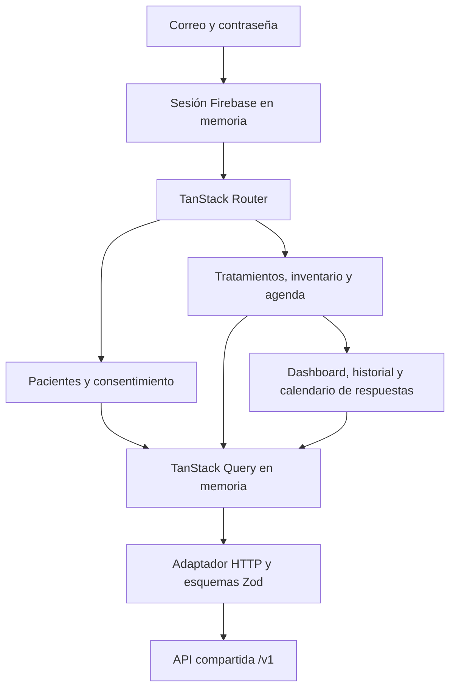

# Mapa del portal web

El portal F3 permite al cuidador solicitar consentimiento, registrar tratamientos, consultar agenda y reconciliar inventario. El paciente acepta o revoca los accesos desde su propia cuenta. La UI muestra registros declarados, sin inferir ingestión ni recomendar dosis.

## Responsabilidades

- [Entrada y rutas](../src/main.tsx) componen Router, Query y el límite de sesión. La selección de paciente pertenece a la ruta y la sección a su parámetro `section`. Las pestañas de paciente viven en el encabezado de [sesión](../src/app/session.tsx). La API no entrega nombres: las etiquetas salen de [`sections.ts`](../src/lib/sections.ts).
- [Sesión](../src/app/session.tsx) controla carga, acceso anónimo y acceso autenticado. El [adaptador Firebase](../src/app/firebase.ts) obtiene tokens y usa persistencia en memoria.
- [Pantallas](../src/features/) contienen pacientes, consentimiento y las secciones de tratamiento, inventario y agenda. No duplican la autorización del backend.
- [Cliente HTTP](../src/lib/api/client.ts) transmite tokens, recorre páginas y valida respuestas con los [esquemas](../src/lib/api/contracts.ts). Los datos clínicos no se guardan en almacenamiento persistente del navegador.
- [Formularios](../src/components/forms.tsx) conservan la clave idempotente mientras se reintenta el mismo contenido. Las [validaciones](../src/lib/forms.ts) mantienen cantidades decimales como texto y comprueban horarios.
- [Configuración Vite](../vite.config.ts) separa la identidad de pruebas de Firebase real. `make web-dev` sirve el portal local y dirige `/v1` a `API_PROXY_TARGET`, configurado en un archivo local ignorado. Sin configuración usa `http://127.0.0.1:8080`; PostgreSQL se accede sólo desde la API. El modo E2E mantiene su API local en el puerto 18083. Un despliegue del portal necesitaría servir web y API bajo el mismo origen.

## Invariantes de la interfaz

Cambiar de identidad limpia la caché. Las respuestas 401, 403 y 404 cierran la sesión local y retiran toda la caché. No se mantienen colas offline de mutaciones en F3.

Las invitaciones se muestran una sola vez al crearlas. Cada envío crea una nueva operación porque el token no se puede recuperar si se pierde la respuesta. La persona que acepta revisa los alcances antes de autorizar. Los tokens no forman parte de rutas ni parámetros de navegación.

Las cantidades viajan como cadenas. El servidor calcula diferencias de inventario y decide si una versión o saldo esperado sigue vigente. Archivar conserva el historial y deja de generar dosis futuras.

La agenda diferencia pendiente, sin confirmar, tomada, tomada tarde y omitida mediante texto. El historial describe declaraciones, no demuestra ingestión.

## Seguimiento F7

La sección Seguimiento permite elegir semana, mes o rango y filtrar un tratamiento del paciente seleccionado. El backend entrega los conteos y proporciones; la UI no agrega una página parcial de agenda. Cada porcentaje muestra su numerador y denominador, y la puntualidad indica su ventana organizativa. El calendario presenta respuestas explícitas, incluidas omisiones, sin rachas ni recompensas por consumo.

[Seguimiento](../src/features/dashboard.tsx) abre con alertas y agenda de hoy de todo el paciente, que el filtro del informe no oculta. La consulta del informe espera a la de hoy: ambas materializan dosis bajo `RepeatableRead` y en paralelo chocan con 409 en un paciente sin materializar. Las [barras apiladas](../src/features/adherence-chart.tsx) usan sólo `report.days`, con leyenda, trama para «sin confirmar», `aria-label` resumen y tabla alternativa.

[Inventario](../src/features/inventory.tsx) es una lista de cuentas con días de cobertura y un detalle. El saldo estimado es `balance − scheduled_quantity`, ambos del servidor, con resta exacta en [`inventory.ts`](../src/lib/inventory.ts); no pasa por float. La API no entrega saldo por día, así que la proyección muestra la parte cubierta de la ventana y no una curva. La tabla de movimientos muestra las cantidades como texto.

El historial usa el mismo filtro y ordena las dosis por instante programado. Los días del calendario conservan la fecha local original de la pauta. Los rangos admiten hasta 366 días, mientras que inventario conserva su proyección de 30 días.

La antelación de reposición se edita en Inventario con permiso `inventory`. El formulario conserva la operación al reintentar y envía el umbral previo esperado para detectar una edición concurrente. La fecha orientativa y la zona horaria provienen de la API. Guardar antelación no activa push.

## Evidencia y límites

El [runbook F3](../../../docs/runbooks/f3-verification.md) registra las pruebas y sus límites. Los contratos, permisos e infraestructura compartidos pertenecen al [mapa general](../../../docs/00-home.md). La [decisión F3](../../../docs/decisions/0004-f3-caregiver-portal.md) explica las alternativas consideradas. La [política común](../../../AGENTS.md#living-architecture) aplica sin duplicarse aquí.

La [verificación F7](../../../docs/runbooks/f7-verification.md) registra el dashboard y sus pruebas. API y worker F7 están desplegados en staging; este portal continúa servido localmente y consulta esa API. El usuario aceptó F7 tras su E2E contra staging el 2026-11-03.

Las pruebas web admiten `E2E_PORT_OFFSET` para levantar API, proxy de fallos y Vite en puertos alternativos de loopback cuando hay servicios locales abiertos. El valor predeterminado conserva los puertos anteriores y el modo normal del portal mantiene su destino staging.
