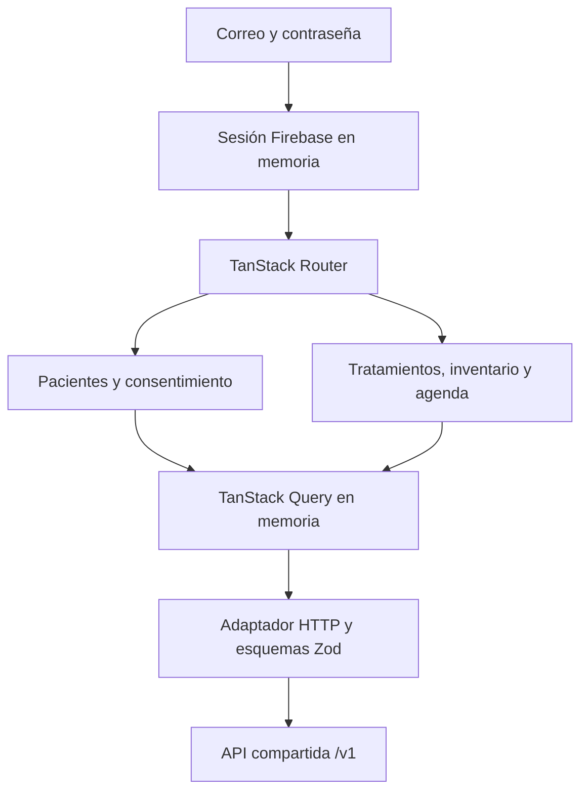

# Mapa del portal web

El portal F3 permite al cuidador solicitar consentimiento, registrar tratamientos, consultar agenda y reconciliar inventario. El paciente acepta o revoca los accesos desde su propia cuenta. La UI muestra registros declarados, sin inferir ingestión ni recomendar dosis.

## Responsabilidades

- [Entrada y rutas](../src/main.tsx) componen Router, Query y el límite de sesión. La selección de paciente pertenece a la ruta.
- [Sesión](../src/app/session.tsx) controla carga, acceso anónimo y acceso autenticado. El [adaptador Firebase](../src/app/firebase.ts) obtiene tokens y usa persistencia en memoria.
- [Pantallas](../src/features/) contienen pacientes, consentimiento y las secciones de tratamiento, inventario y agenda. No duplican la autorización del backend.
- [Cliente HTTP](../src/lib/api/client.ts) transmite tokens, recorre páginas y valida respuestas con los [esquemas](../src/lib/api/contracts.ts). Los datos clínicos no se guardan en almacenamiento persistente del navegador.
- [Formularios](../src/components/forms.tsx) conservan la clave idempotente mientras se reintenta el mismo contenido. Las [validaciones](../src/lib/forms.ts) mantienen cantidades decimales como texto y comprueban horarios.
- [Configuración Vite](../vite.config.ts) separa la identidad de pruebas de Firebase productivo. El desarrollo usa proxy para `/v1`; un despliegue necesitaría servir web y API bajo el mismo origen.

## Invariantes de la interfaz

Cambiar de identidad limpia la caché. Las respuestas 401, 403 y 404 cierran la sesión local y retiran toda la caché. No se mantienen colas offline de mutaciones en F3.

Las invitaciones se muestran una sola vez al crearlas. Cada envío crea una nueva operación porque el token no se puede recuperar si se pierde la respuesta. La persona que acepta revisa los alcances antes de autorizar. Los tokens no forman parte de rutas ni parámetros de navegación.

Las cantidades viajan como cadenas. El servidor calcula diferencias de inventario y decide si una versión o saldo esperado sigue vigente. Archivar conserva el historial y deja de generar dosis futuras.

La agenda diferencia pendiente, sin confirmar, tomada, tomada tarde y omitida mediante texto. El historial describe declaraciones, no demuestra ingestión.

## Evidencia y límites

El [runbook F3](../../../docs/runbooks/f3-verification.md) registra las pruebas y sus límites. Los contratos, permisos e infraestructura compartidos pertenecen al [mapa general](../../../docs/00-home.md). La [decisión F3](../../../docs/decisions/0004-f3-caregiver-portal.md) explica las alternativas consideradas. La [política común](../../../AGENTS.md#living-architecture) aplica sin duplicarse aquí.
