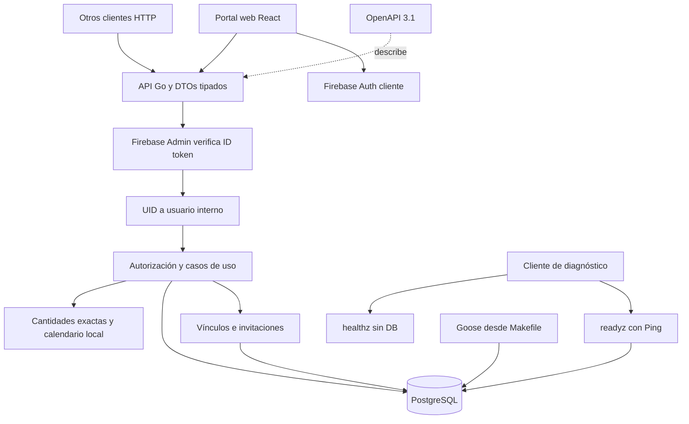

# Mapa del monorepo

El portal web del cuidador consume la API Go. Firebase verifica identidad y PostgreSQL conserva permisos, consentimiento e historial. Las apps móviles y el worker siguen como carpetas reservadas, sin ejecutables.

## Límites y responsabilidades

- [API](../services/api/cmd/api/main.go) compone configuración, pool, verificador y servidor. Las probes son públicas. `healthz` no consulta la base y `readyz` hace Ping.
- [HTTP](../services/api/internal/http/api.go) verifica identidad, limita peticiones y adapta JSON. Usa cantidades decimales como texto y errores sin contenido médico. Los logs contienen metadatos de petición, sin tokens, cuerpos ni URLs.
- [Aplicación](../services/api/internal/application/service.go) autoriza antes de consultar respuestas idempotentes. Resuelve el paciente desde el recurso y mantiene el bloqueo compartido del vínculo hasta terminar la transacción. El propio paciente puede operar sus datos. Los cuidadores necesitan consentimiento activo y el alcance correspondiente.
- [Consentimiento](../services/api/internal/application/consent.go) emite invitaciones con hash de token, registra aceptación y revocación. Reactivar un vínculo requiere consentimiento nuevo.
- [Dominio](../services/api/internal/domain) conserva cantidades exactas y reglas de calendario de F1. La consulta de agenda materializa ocurrencias mediante ese generador, sin worker.
- [Operaciones del portal](../services/api/internal/application/portal.go) conservan auditoría de metadatos, archivo y conteos físicos. El archivo limita agenda y proyección. El conteo compara el saldo esperado bajo bloqueo de cuenta y crea un ajuste exacto sólo si existe diferencia.
- [OpenAPI](../packages/contracts/openapi.yaml) es el contrato compartido. Los adaptadores son manuales y tipados. No hay clientes móviles o web generados.
- [Compose](../compose.yaml) mantiene PostgreSQL y su volumen. El puerto host predeterminado es 55433 y el puerto del contenedor es 5432.

## Mapas por app

| App | Mapa local | Estado |
| --- | --- | --- |
| iOS | [Mapa iOS](../apps/ios/docs/00-home.md) | Carpetas reservadas, sin proyecto Xcode |
| Android | [Mapa Android](../apps/android/docs/00-home.md) | Carpetas reservadas, sin proyecto Gradle compilable |
| Web | [Mapa web](../apps/web/docs/00-home.md) | Portal React con login, consentimiento, tratamientos, inventario y agenda |

Los detalles internos de cada app se documentan en su mapa local cuando se implementan. Los límites compartidos permanecen aquí. La UI no se comparte entre plataformas.

## Contexto y evidencia

- [PLAN.md](../PLAN.md) define fases y diseño previsto; no acredita implementación.
- [Decisión de bootstrap](decisions/0001-bootstrap.md) explica la separación de paquetes y dependencias.
- [Decisión de dominio F1](decisions/0002-f1-domain.md) explica las transacciones, cantidades y calendario de F1.
- [Decisión HTTP e identidad F2](decisions/0003-f2-http-identity.md) explica permisos transaccionales, consentimiento y límites de la API.
- [README](../README.md) contiene onboarding y comandos operacionales.
- [Verificación F0](runbooks/f0-verification.md) registra las pruebas locales realizadas; no acredita despliegue en producción.
- [Verificación F1](runbooks/f1-verification.md) registra pruebas de dominio, integración y reversibilidad de migraciones en una base desechable.
- [Verificación F2](runbooks/f2-verification.md) registra pruebas HTTP, permisos, firmas locales y migraciones desechables.
- [AGENTS.md](../AGENTS.md#living-architecture) define cómo mantener este mapa y los mapas locales.

- [Decisión del portal F3](decisions/0004-f3-caregiver-portal.md) explica sesión en memoria, archivo auditable y conteos físicos.
- [Verificación F3](runbooks/f3-verification.md) distingue pruebas reales de HTTP y PostgreSQL, identidad sintética y verificaciones pendientes de Firebase.
