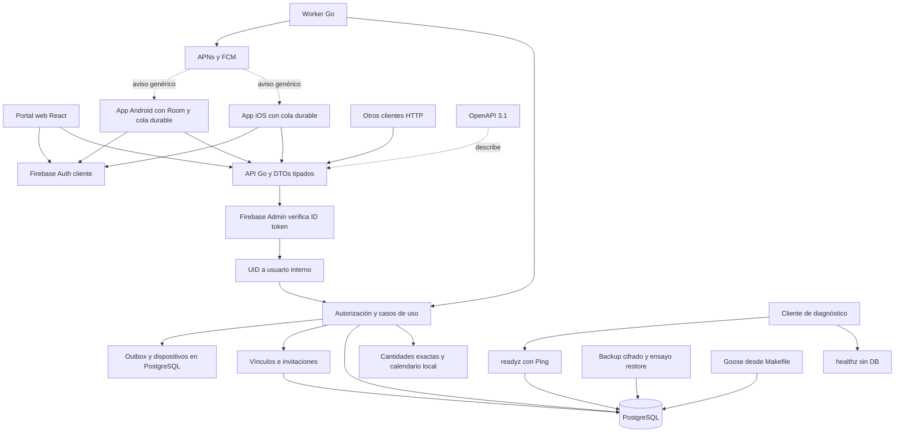
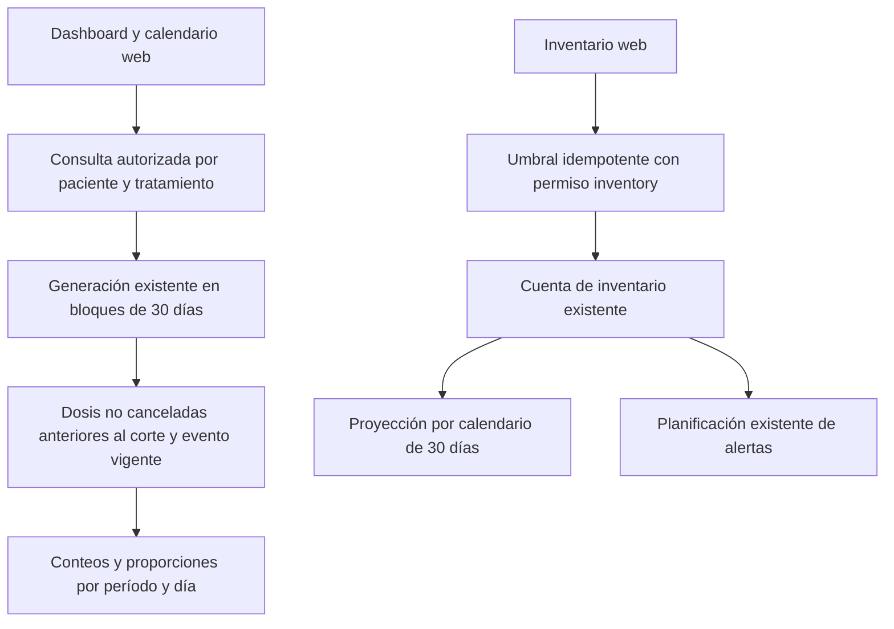
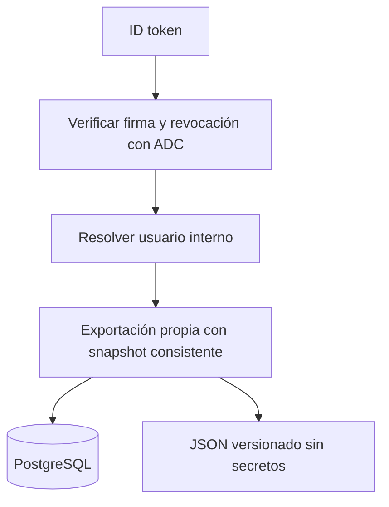
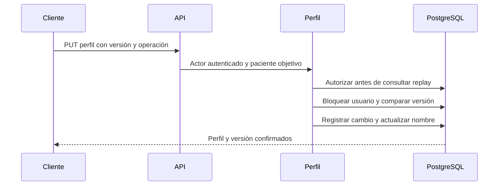

# Mapa del monorepo

El portal web del cuidador y las apps iOS y Android del paciente consumen la API Go. Firebase verifica identidad y PostgreSQL conserva permisos, consentimiento e historial. El worker Go comparte módulo con la API y procesa una outbox de alertas. APNs y FCM tienen adaptadores y registro nativo, con entrega remota aún pendiente de verificar. Android tiene proyecto compilable y pruebas en emulador. F5 está aceptada por el usuario tras revisión en teléfono físico, con cobertura pendiente documentada.

## Límites y responsabilidades

- [API](../services/api/cmd/api/main.go) compone configuración, pool, verificador y servidor. Las probes son públicas. `healthz` no consulta la base y `readyz` hace Ping.
- [HTTP](../services/api/internal/http/api.go) verifica identidad, limita peticiones y adapta JSON. Usa cantidades decimales como texto y errores sin contenido médico. Los logs contienen metadatos de petición, sin tokens, cuerpos ni URLs.
- [Aplicación](../services/api/internal/application/service.go) autoriza antes de consultar respuestas idempotentes. Resuelve el paciente desde el recurso y mantiene el bloqueo compartido del vínculo hasta terminar la transacción. El propio paciente puede operar sus datos. Los cuidadores necesitan consentimiento activo y el alcance correspondiente.
- [Consentimiento](../services/api/internal/application/consent.go) emite invitaciones con hash de token, registra aceptación y revocación. Reactivar un vínculo requiere consentimiento nuevo.
- [Dominio](../services/api/internal/domain) conserva cantidades exactas y reglas de calendario de F1. La consulta de agenda y el worker materializan ocurrencias mediante el mismo generador.
- [Operaciones del portal](../services/api/internal/application/portal.go) conservan auditoría de metadatos, archivo y conteos físicos. El archivo limita agenda y proyección. El conteo compara el saldo esperado bajo bloqueo de cuenta y crea un ajuste exacto sólo si existe diferencia.
- [OpenAPI](../packages/contracts/openapi.yaml) es el contrato compartido. Los adaptadores son manuales y tipados. No hay clientes móviles o web generados.
- [`cmd/e2e`](../services/api/cmd/e2e/main.go), sólo con la etiqueta `e2e`, acepta identidades sintéticas o del emulador de Firebase y añade un [proxy de fallos](../services/api/cmd/e2e/proxy.go). Exige una base local desechable. El ejecutable productivo sigue rechazando el emulador.
- [Compose](../compose.yaml) mantiene PostgreSQL y su volumen. El puerto host predeterminado es 55433 y el puerto del contenedor es 5432.

## Mapas por app

| App | Mapa local | Estado |
| --- | --- | --- |
| iOS | [Mapa iOS](../apps/ios/docs/00-home.md) | App SwiftUI del paciente. Flujo completo verificado en simulador; en iPhone físico, instalación y login |
| Android | [Mapa Android](../apps/android/docs/00-home.md) | Compose, Room, consentimiento y recordatorios. Verificación en emulador y aceptación del usuario en teléfono físico; cobertura pendiente en el runbook |
| Web | [Mapa web](../apps/web/docs/00-home.md) | Portal React con login, consentimiento, tratamientos, inventario y agenda |

Los detalles internos de cada app se documentan en su mapa local cuando se implementan. Los límites compartidos permanecen aquí. La UI no se comparte entre plataformas.

## Contexto y evidencia

- [PLAN.md](../PLAN.md) define fases y diseño previsto; no acredita implementación.
- [Decisión de bootstrap](decisions/0001-bootstrap.md) explica la separación de paquetes y dependencias.
- [Decisión de dominio F1](decisions/0002-f1-domain.md) explica las transacciones, cantidades y calendario de F1.
- [Decisión HTTP e identidad F2](decisions/0003-f2-http-identity.md) explica permisos transaccionales, consentimiento y límites de la API.
- [README](../README.md) contiene onboarding y comandos operacionales.
- [Verificación F0](runbooks/f0-verification.md) registra las pruebas locales realizadas; no acredita despliegue en producción.
- [Verificación F1](runbooks/f1-verification.md) registra pruebas de dominio, integración y reversibilidad de migraciones en una base desechable.
- [Verificación F2](runbooks/f2-verification.md) registra pruebas HTTP, permisos, firmas locales y migraciones desechables.
- [AGENTS.md](../AGENTS.md#living-architecture) define cómo mantener este mapa y los mapas locales.

- [Decisión del portal F3](decisions/0004-f3-caregiver-portal.md) explica sesión en memoria, archivo auditable y conteos físicos.
- [Verificación F3](runbooks/f3-verification.md) distingue pruebas reales de HTTP y PostgreSQL, identidad sintética y verificaciones pendientes de Firebase.
- [Decisión de la app iOS F4](decisions/0005-f4-ios-patient-app.md) explica el proyecto generado, la identidad por REST, la cola durable y los recordatorios.
- [Verificación F4](runbooks/f4-verification.md) distingue lo comprobado en simulador y en iPhone físico de lo pendiente.

- [Decisión Android F5](decisions/0006-f5-android-patient-app.md) explica identidad, separación de paciente, cola y alarmas.
- [Verificación F5](runbooks/f5-verification.md) distingue pruebas de emulador y pendientes físicos.

## Alertas y resiliencia F6

[Worker](../services/api/cmd/worker/main.go) materializa una ventana de agenda, evalúa preferencias por vínculo y procesa [outbox](../services/api/internal/application/alerts.go). Una reserva durable precede cada envío. Los resultados inciertos no se reenvían automáticamente. La frecuencia se reserva por cuidador, incluso entre sus dispositivos. Consentimiento, token y condición se revisan antes de reservar.

[Dispositivos](../services/api/internal/application/devices.go) pertenecen al actor autenticado. Los tokens no aparecen en respuestas ni logs. Las preferencias están vinculadas a la generación de consentimiento. Las alertas están desactivadas hasta configurarlas. El payload push es genérico y no concede acceso a datos.

[Reconciliación](../services/api/internal/application/reconcile.go) inspecciona estado, consumo, ledger, ventana de agenda y entregas/dispositivos obsoletos. No reescribe historia. [Métricas](../services/api/internal/observability/metrics.go) sirven contadores agregados en listeners privados. El [backup](../services/api/cmd/backup/main.go) cifra dumps y restringe el restore de ensayo a bases locales vacías.

El worker comparte transacciones y reglas del backend, pero es un proceso separado. La planificación bloquea tratamientos dentro de un ciclo global y está pensada para escala familiar. Antes de aumentar volumen hay que medir su duración y contención.

- [Decisión F6](decisions/0007-f6-alerts-resilience.md).
- [Recuperación y staging](runbooks/f6-recovery.md).
- [Verificación F6](runbooks/f6-verification.md).

## Despliegue Railway

El proyecto `medication-tracker` contiene `staging` con PostgreSQL, API y worker separados, y `production` reservado sin instancias ni volúmenes. Sólo la API publica HTTPS. PostgreSQL usa red privada y TLS con validación de nombre y CA mediante el [pool compartido](../services/api/internal/config/database.go). El worker mantiene push desactivado. Firebase de staging usa `<firebase-project-id>`; el usuario aceptó el flujo manual con web y teléfonos. Las probes públicas funcionan y los endpoints protegidos requieren token. Ver [operación y evidencia](runbooks/railway-staging.md).

## Seguimiento F7

El dashboard web consulta [métricas de declaraciones](../services/api/internal/application/adherence.go) en una transacción autorizada. El backend materializa el rango usando las revisiones existentes y agrega las dosis evaluables con su evento vigente. El historial usa el mismo rango y filtro de tratamiento. Las fechas son las locales originales de cada dosis, incluso cuando cambia la zona entre revisiones.

Las correcciones cambian el resultado efectivo sin sumar otra dosis al denominador. Una omisión explícita cuenta como respuesta en el calendario. No hay premios por consumo ni inferencias de ingestión. La antelación de reposición se guarda en la cuenta existente y no crea movimientos de stock.

No hay migraciones ni cambios de clientes móviles en F7. API y worker F7 están desplegados en staging. El portal continúa local; el usuario aceptó F7 tras su E2E contra staging el 2026-11-03. Ver [decisión F7](decisions/0008-f7-dashboard.md) y [verificación F7](runbooks/f7-verification.md).

## Endurecimiento F8

La API verifica firma y revocación de Firebase mediante credenciales administrativas externas. Una cuenta deshabilitada, eliminada o con token revocado no alcanza `ResolveUser`. Una indisponibilidad del proveedor rechaza la sesión. Esta dependencia no está desplegada ni verificada contra Firebase remoto en F8.

`GET /v1/me/export` obtiene una instantánea de la cuenta propia mediante [ExportAccount](../services/api/internal/application/export.go). Selecciona campos explícitos, convierte cantidades en cadenas exactas y excluye secretos e historia clínica de otros pacientes, incluso si el actor es cuidador. La respuesta tiene versión, límite de filas/bytes y máximo de dos exportaciones simultáneas por proceso. No materializa agenda futura ni crea archivos en el servidor.

El esquema de datos no cambia. Borrado de cuenta y supresiones de backups siguen pendientes de política e implementación. Los workflows separan Go, web, Android e iOS habilitable. No hay publicación ni despliegue F8. Ver [seguridad](runbooks/f8-security.md), [evidencia](runbooks/f8-verification.md), [release](runbooks/f8-release.md) y [entrega a Claude](design/claude-redesign-handoff.md).

Los valores visuales compartidos viven en [`packages/design-tokens/tokens.json`](../packages/design-tokens/README.md). Un generador sin dependencias produce adaptadores para CSS, SwiftUI y Compose, y `make tokens-check` valida sincronía y contraste. Las apps no comparten componentes de UI. Las tres apps implementan el rediseño Graphite sin cambios de API, dominio ni colas; el estado está en la [guía de rediseño](design/claude-redesign-handoff.md).

## Perfiles y nombres P1

La migración `00006_profiles.sql` distingue un perfil sin completar del nombre histórico de bootstrap. Las lecturas de perfil, pacientes, vínculos, invitaciones y exportación devuelven nombre nulo hasta completarlo. Cada persona tiene un único nombre compartido.

[UpdateProfile](../services/api/internal/application/profiles.go) permite editar al propio usuario o a un cuidador con vínculo activo y alcance `treatments`. Usa el mismo registro idempotente que las otras mutaciones. Un cuidador que sólo puede leer recibe 403; un extraño recibe 404. La autorización se repite antes de devolver una respuesta guardada.

[AcceptInvitation](../services/api/internal/application/consent.go) aplica el nombre sugerido sólo al perfil incompleto, bajo bloqueo y dentro de la transacción de consentimiento. El cambio queda en `user_profile_changes`. La revocación continúa permitida al paciente y al cuidador del vínculo.

Los vínculos revocados conservan su referencia histórica, pero no revelan el nombre actual de la contraparte. Los nombres rechazan NUL y saltos de línea antes de llegar a PostgreSQL.

Las consultas de agenda e informe mantienen `RepeatableRead` y reintentan la transacción completa hasta tres intentos ante serialización, interbloqueo o unicidad durante materialización. La espera de 50 a 200 ms admite cancelación. La traducción a error HTTP ocurre después de decidir el reintento. [Pruebas HTTP P1](../services/api/internal/http/profiles_integration_test.go) cubren consultas concurrentes contra PostgreSQL.

Estos cambios no implementan aún la navegación multi-paciente ni el inventario compartido. Su despliegue no está verificado.

La respuesta de pacientes incluye la zona IANA ya guardada en `users.timezone`. El portal P2 la usa para delimitar el día de sus tarjetas, sin inferirla desde una pauta ni cambiar el modelo de horarios.
