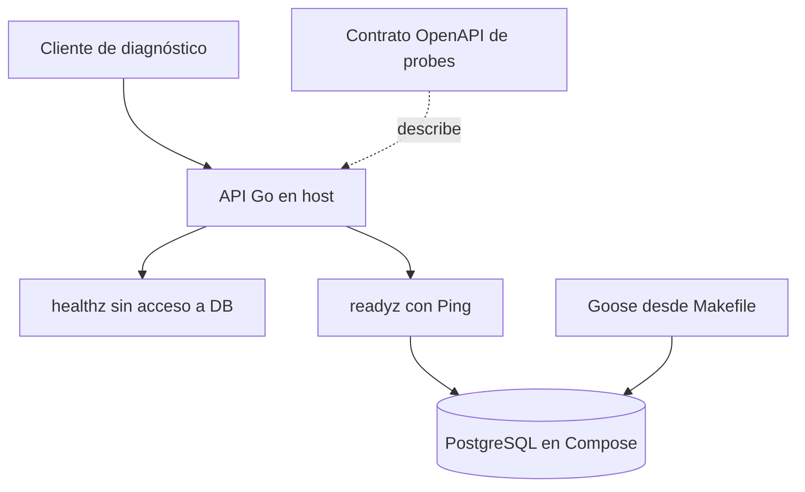

# Mapa del monorepo

El sistema implementado corresponde a F0. La API Go expone probes operacionales y PostgreSQL contiene la tabla `users`. Las apps y el worker son carpetas reservadas, sin ejecutables.

## Límites y responsabilidades

- [API](../services/api/cmd/api/main.go) compone configuración, pool y servidor; no implementa autenticación ni reglas de medicamentos.
- [Probes](../services/api/internal/http/health.go) separan liveness de conectividad. Readiness comprueba Ping con timeout de dos segundos; no verifica la versión del esquema.
- [Migraciones](../infrastructure/migrations/00001_create_users.sql) poseen el esquema. La API no aplica migraciones al arrancar ni expone operaciones sobre `users`.
- [OpenAPI](../packages/contracts/openapi.yaml) contiene el contrato HTTP compartido. No hay clientes generados ni tokens de diseño implementados.
- [Compose](../compose.yaml) mantiene PostgreSQL y su volumen. El puerto host predeterminado es 55433 y el puerto del contenedor es 5432.

## Mapas por app

| App | Mapa local | Estado |
| --- | --- | --- |
| iOS | [Mapa iOS](../apps/ios/docs/00-home.md) | Carpetas reservadas, sin proyecto Xcode |
| Android | [Mapa Android](../apps/android/docs/00-home.md) | Carpetas reservadas, sin proyecto Gradle compilable |
| Web | [Mapa web](../apps/web/docs/00-home.md) | Carpetas reservadas, sin paquete ni runtime |

Los detalles internos de cada app se documentan en su mapa local cuando se implementan. Los límites compartidos permanecen aquí. La UI no se comparte entre plataformas.

## Contexto y evidencia

- [PLAN.md](../PLAN.md) define fases y diseño previsto; no acredita implementación.
- [Decisión de bootstrap](decisions/0001-bootstrap.md) explica la separación de paquetes y dependencias.
- [README](../README.md) contiene onboarding y comandos operacionales.
- [Verificación F0](runbooks/f0-verification.md) registra las pruebas locales realizadas; no acredita despliegue en producción.
- [AGENTS.md](../AGENTS.md#living-architecture) define cómo mantener este mapa y los mapas locales.
